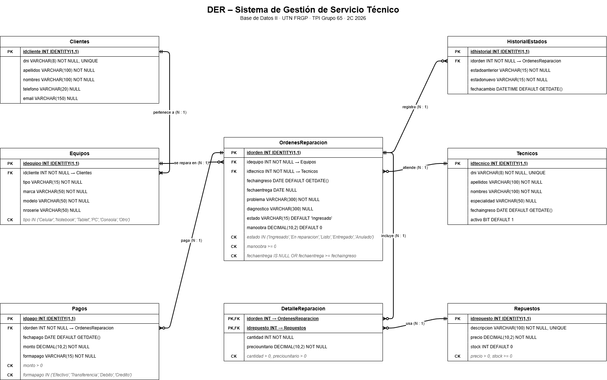

# TPI Base de Datos II — Sistema de Gestión de Servicio Técnico

Trabajo Práctico Integrador de **Base de Datos II** — Tecnicatura Universitaria en Programación, UTN FRGP (2.º cuatrimestre 2026). **Grupo 65.**

Base de datos relacional en **SQL Server** para un local que repara equipos electrónicos (celulares, notebooks, tablets, PC y consolas): clientes y equipos, órdenes de reparación con su estado, técnico responsable, repuestos usados, pagos e historial de estados.

## Contenido

| Carpeta / archivo | Qué es |
|---|---|
| `01_Creacion_Grupo65_ServicioTecnico.sql` | Crea la base `TPIGrupo65_ServicioTecnico` y sus 8 tablas con PK, FK, UNIQUE, CHECK y DEFAULT |
| `02_Datos_Grupo65_ServicioTecnico.sql` | Datos de ejemplo para las 8 tablas |
| `vistas/` | 3 vistas |
| `procedimientos/` | 2 procedimientos almacenados (uno de acción, uno de reporte) |
| `triggers/` | 3 triggers (INSERT, DELETE y UPDATE) |
| `pruebas/` | Casos de prueba de las vistas, los procedimientos y los triggers |
| `der/` | Diagrama de entidad-relación |
| `00_Ejecutar_todo.sql` | Corre todo lo anterior en el orden correcto |

## Cómo ejecutarlo

Necesita SQL Server (probado en SQL Server Express). Desde la carpeta del repositorio:

```bash
sqlcmd -S .\SQLEXPRESS -E -C -f 65001 -i 00_Ejecutar_todo.sql
```

También se puede ejecutar a mano, archivo por archivo, en este orden: creación → datos → vistas → procedimientos → triggers. Los triggers van **al final**: los datos de ejemplo ya tienen el stock descontado, y `TR_DescontarStock` no tiene que volver a descontarlo.

Para probar, abrir los archivos de `pruebas/` y ejecutar los casos de a uno. Los de triggers corren dentro de una transacción con `ROLLBACK`, así que se pueden repetir sin alterar los datos.

## Modelo de datos



Tablas: `Clientes`, `Tecnicos`, `Equipos`, `Repuestos`, `OrdenesReparacion`, `DetalleReparacion` (PK compuesta), `Pagos` e `HistorialEstados`.

## Objetos de programación

### Vistas
- **`VW_OrdenesPendientes`**: órdenes que siguen en el taller (excluye Entregado y Anulado) y cuántos días llevan, con `DATEDIFF`.
- **`VW_SaldoOrdenes`**: mano de obra, repuestos, total de la orden, total pagado y saldo pendiente de cada orden.
- **`VW_RepuestosBajoStock`**: repuestos con menos de 5 unidades.

### Procedimientos almacenados
- **`SP_RegistrarOrden`** (acción): registra una orden nueva. Valida que el equipo exista y que el técnico exista y esté activo; usa transacción con `TRY/CATCH` y hace `ROLLBACK` si algo falla.
- **`SP_ReporteTecnico`** (reporte): para un rango de fechas, devuelve por técnico las órdenes atendidas, las entregadas y el total facturado.

### Triggers
- **`TR_DescontarStock`** (`AFTER INSERT` en `DetalleReparacion`): descuenta el stock del repuesto; si no alcanza, hace `ROLLBACK` e informa el error.
- **`TR_AnularOrden`** (`INSTEAD OF DELETE` en `OrdenesReparacion`): una orden con pagos no se borra, pasa a `Anulado`; una orden sin pagos se elimina junto con su detalle e historial y los repuestos vuelven al stock.
- **`TR_HistorialEstado`** (`AFTER UPDATE` en `OrdenesReparacion`): registra en `HistorialEstados` cada cambio de estado.
